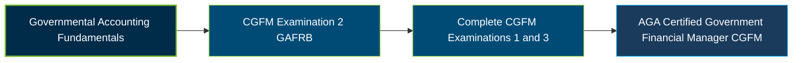

# AGA Governmental Accounting, Financial Reporting and Budgeting (GAFRB) Exam Guide

A dedicated, comprehensive study guide and government accounting reference repository for candidates preparing for the **AGA Governmental Accounting, Financial Reporting and Budgeting (GAFRB) Examination**, part of the Certified Government Financial Manager (CGFM) program.

---

## Exam Overview

The AGA GAFRB examination evaluates knowledge of governmental accounting principles, financial reporting standards, budgeting practices, and federal, state, and local government financial operations.

- **Exam Format**: Computerized examination administered through Pearson VUE testing centers or OnVUE online proctoring.
- **Target Audience**: Government Accountants, Financial Reporting Specialists, Budget Analysts, Auditors, Government Controllers, and Public-Sector Finance Professionals.
- **Prerequisites**: A bachelor's degree from an accredited college or university is required to take CGFM examinations. AGA requires official degree documentation before an examination can be taken.

---

## Core Exam Domains & Knowledge Areas

### 1. Governmental Financial Accounting, Reporting and Budgeting: General Knowledge

- Government financial reporting objectives, accountability, interperiod equity, accounting standards, and the roles of GASB, FASAB, FASB, and IPSASB.
- Managerial cost accounting, cost allocation, fee establishment, full-cost concepts, and cost recovery methods.
- Government budgeting processes, budget structures, forecasting, budgetary controls, and general accounting principles.

### 2. State and Local Financial Accounting and Reporting

- GASB standards, reporting entities, fund classifications, Annual Comprehensive Financial Reports (ACFRs), and government-wide and fund-level financial statements.
- Modified accrual and accrual accounting, assets, liabilities, revenues, expenditures, capital assets, long-term obligations, and interfund transactions.
- State and local budgetary accounting, encumbrances, fund balance reporting, financial statement reconciliation, and government combinations.

### 3. Federal Financial Accounting and Reporting

- FASAB standards, federal reporting entities, and the roles of OMB, U.S. Treasury, and GAO in federal financial management.
- Federal budgetary and proprietary accounting, appropriations, apportionments, obligations, fund types, and the U.S. Standard General Ledger.
- Agency Financial Reports (AFRs), Performance and Accountability Reports (PARs), federal financial statements, intragovernmental transactions, and Fund Balance with Treasury.

---

## Certification Path

The following diagram illustrates a suggested study progression within the CGFM program. It does not represent a required examination order.

---

## Recommended Practice & Study Resources

Combine official AGA preparation materials with accounting standards and practical government financial reporting exercises to strengthen your GAFRB exam knowledge.

- **CertsGate**: Explore [AGA GAFRB exam preparation resources](https://certsgate.com/exams/aga/gafrb), including supplementary study materials and practice questions for reviewing governmental accounting, financial reporting, and budgeting concepts.
- **Practical Study Resources**: Review [GASB standards](https://www.gasb.org/), [FASAB guidance](https://fasab.gov/), and federal financial reporting materials. Practice interpreting ACFRs, fund statements, budget reconciliations, and federal agency financial reports.
